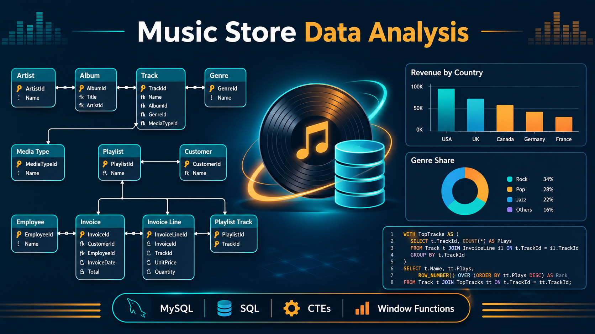

# Music Store Data Analysis 🎧



An SQL-based exploratory data analysis project using a relational music-store database. The project explores sales performance, customer behavior, RFM segmentation, churn risk, and purchasing trends to support data-driven business decisions.

## Table of Contents

- [Introduction](#introduction)
- [Dataset](#dataset)
- [Enhanced Analysis Features](#enhanced-analysis-features)
- [SQL Queries](#sql-queries)
- [Python Runner](#python-runner)
- [ER Diagram](#er-diagram)
- [Key Findings](#key-findings)
- [Project Structure](#project-structure)
- [Getting Started](#getting-started)

## Introduction

The **Music Store Data Analysis** project uses SQL to explore a music store's transactional and catalog data. This enhanced version includes:

- **RFM Segmentation** - Recency, Frequency, Monetary scoring to identify customer value tiers
- **Churn Detection** - Flag customers at risk based on purchase inactivity
- **Time-Series Analysis** - MoM growth, cohort retention, running totals
- **Performance Tuning** - Index optimization with EXPLAIN analysis
- **Python Analytics** - SQLAlchemy + pandas runner with visualization export

## Dataset

The database contains 11 related tables:

| Table | Description |
| --- | --- |
| `Artist` | Artist information |
| `Album` | Albums and their associated artists |
| `Track` | Individual music tracks and catalog details |
| `Genre` | Music genres |
| `MediaType` | Track media formats |
| `Playlist` | Playlist details |
| `PlaylistTrack` | Many-to-many relationship between playlists and tracks |
| `Customer` | Customer details and country information |
| `Employee` | Employee details and reporting structure |
| `Invoice` | Invoice header and billing information |
| `InvoiceLine` | Individual tracks purchased on each invoice |

### Sample Data Structure

**Invoice.csv**
```
invoice_id,customer_id,invoice_date,billing_address,billing_city,billing_state,billing_country,billing_postal_code,total
1,18,2017-01-03 00:00:00,627 Broadway,New York,NY,USA,10012-2612,15.84
```

**InvoiceLine.csv**
```
invoice_line_id,invoice_id,track_id,unit_price,quantity
1,1,1158,0.99,1
```

## Enhanced Analysis Features

### RFM Segmentation
- **Recency (R)**: Days since last purchase (lower = better)
- **Frequency (F)**: Total number of purchases (higher = better)
- **Monetary (M)**: Total amount spent (higher = better)
- Scores using NTILE(5) for each dimension
- Combined RFM scores: 111 (best) to 555 (churn risk)

### Churn Detection
- 180-day inactivity threshold
- Flags customers at risk of churning
- Segment breakdown: Champions, Loyal, At-Risk, Hibernating

### Time-Series Metrics
- Month-over-Month (MoM) revenue growth using LAG()
- Customer cohort retention analysis
- Running revenue totals with window functions

### Performance Tuning
- Strategic indexes on high-cardinality columns
- EXPLAIN analysis before/after optimization
- Query performance benchmarks

## SQL Queries

### Basic Analysis (Easy)

#### Q1. Senior most employee by hire date
```sql
SELECT employee_id, first_name, last_name, title, hire_date
FROM employee
ORDER BY hire_date ASC
LIMIT 1;
```

#### Q2. Countries with most invoices
```sql
SELECT billing_country, COUNT(invoice_id) AS invoice_count
FROM invoice
GROUP BY billing_country
ORDER BY invoice_count DESC;
```

#### Q3. Top 3 invoice totals
```sql
SELECT total, invoice_id, invoice_date
FROM invoice
ORDER BY total DESC
LIMIT 3;
```

#### Q4. City with highest revenue
```sql
SELECT billing_city, SUM(total) AS revenue
FROM invoice
GROUP BY billing_city
ORDER BY revenue DESC
LIMIT 1;
```

#### Q5. Best customer by total spending
```sql
SELECT c.customer_id, c.first_name, c.last_name, SUM(i.total) AS total_spent
FROM customer c
JOIN invoice i ON c.customer_id = i.customer_id
GROUP BY c.customer_id
ORDER BY total_spent DESC
LIMIT 1;
```

### Intermediate Analysis (Moderate)

#### Q6. Rock music listeners
```sql
SELECT DISTINCT c.email, c.first_name, c.last_name, g.name AS genre
FROM customer c
JOIN invoice i ON c.customer_id = i.customer_id
JOIN invoice_line il ON i.invoice_id = il.invoice_id
JOIN track t ON il.track_id = t.track_id
JOIN genre g ON t.genre_id = g.genre_id
WHERE g.name = 'Rock'
ORDER BY c.email;
```

#### Q7. Top 10 rock artists by track count
```sql
SELECT a.name, COUNT(t.track_id) AS track_count
FROM artist a
JOIN album al ON a.artist_id = al.artist_id
JOIN track t ON al.album_id = t.album_id
JOIN genre g ON t.genre_id = g.genre_id
WHERE g.name = 'Rock'
GROUP BY a.artist_id
ORDER BY track_count DESC
LIMIT 10;
```

#### Q8. Tracks longer than average length
```sql
SELECT name, milliseconds
FROM track
WHERE milliseconds > (SELECT AVG(milliseconds) FROM track)
ORDER BY milliseconds DESC;
```

### Advanced Analysis

#### Q9. RFM Segmentation
```sql
WITH rfm_base AS (
    SELECT 
        c.customer_id,
        c.first_name,
        c.last_name,
        DATEDIFF('2017-12-31', MAX(i.invoice_date)) AS recency,
        COUNT(DISTINCT i.invoice_id) AS frequency,
        SUM(i.total) AS monetary
    FROM customer c
    JOIN invoice i ON c.customer_id = i.customer_id
    GROUP BY c.customer_id, c.first_name, c.last_name
),
rfm_scores AS (
    SELECT *,
        NTILE(5) OVER (ORDER BY recency DESC) AS r_score,
        NTILE(5) OVER (ORDER BY frequency) AS f_score,
        NTILE(5) OVER (ORDER BY monetary) AS m_score
    FROM rfm_base
)
SELECT 
    customer_id, first_name, last_name, r_score, f_score, m_score,
    CONCAT(r_score, f_score, m_score) AS rfm_segment,
    CASE 
        WHEN r_score >= 4 AND f_score >= 4 AND m_score >= 4 THEN 'Champions'
        WHEN r_score >= 3 AND f_score >= 3 THEN 'Loyal'
        WHEN r_score <= 2 THEN 'At-Risk'
        ELSE 'Hibernating'
    END AS customer_segment
FROM rfm_scores
ORDER BY monetary DESC;
```

#### Q10. Churn Detection (180-day inactivity)
```sql
WITH last_purchase AS (
    SELECT 
        c.customer_id,
        MAX(i.invoice_date) AS last_purchase_date,
        DATEDIFF('2017-12-31', MAX(i.invoice_date)) AS days_since_last
    FROM customer c
    LEFT JOIN invoice i ON c.customer_id = i.customer_id
    GROUP BY c.customer_id
)
SELECT 
    customer_id,
    last_purchase_date,
    days_since_last,
    CASE 
        WHEN days_since_last > 180 THEN 'Churn Risk'
        WHEN days_since_last > 90 THEN 'At Risk'
        ELSE 'Active'
    END AS churn_status,
    COUNT(*) OVER() AS total_customers
FROM last_purchase
ORDER BY days_since_last DESC;
```

#### Q11. Month-over-Month Revenue Growth
```sql
WITH monthly_revenue AS (
    SELECT 
        DATE_FORMAT(invoice_date, '%Y-%m') AS month,
        SUM(total) AS monthly_revenue
    FROM invoice
    GROUP BY DATE_FORMAT(invoice_date, '%Y-%m')
)
SELECT 
    month,
    monthly_revenue,
    LAG(monthly_revenue, 1) OVER (ORDER BY month) AS prev_month_revenue,
    ROUND((monthly_revenue - LAG(monthly_revenue, 1) OVER (ORDER BY month)) 
          / LAG(monthly_revenue, 1) OVER (ORDER BY month) * 100, 2) AS mom_growth_pct,
    SUM(monthly_revenue) OVER (ORDER BY month) AS running_total
FROM monthly_revenue
ORDER BY month;
```

#### Q12. Customer Cohort Retention
```sql
WITH cohort AS (
    SELECT 
        customer_id,
        DATE_FORMAT(MIN(invoice_date), '%Y-%m') AS cohort_month,
        COUNT(DISTINCT DATE_FORMAT(invoice_date, '%Y-%m')) AS months_active
    FROM invoice
    GROUP BY customer_id
)
SELECT 
    cohort_month,
    COUNT(*) AS total_customers,
    AVG(months_active) AS avg_months_active,
    ROUND(AVG(months_active) * 100 / 12, 1) AS retention_rate_pct
FROM cohort
GROUP BY cohort_month
ORDER BY cohort_month;
```

### Performance Optimization

#### Index Creation
```sql
-- Analyze slow queries first
EXPLAIN SELECT c.customer_id, SUM(i.total) AS total_spent
FROM customer c JOIN invoice i ON c.customer_id = i.customer_id
GROUP BY c.customer_id;

-- Create indexes for performance
CREATE INDEX idx_invoice_customer_id ON invoice(customer_id);
CREATE INDEX idx_invoice_date ON invoice(invoice_date);
CREATE INDEX idx_invoiceline_track ON invoice_line(track_id);

-- Verify improvement
EXPLAIN SELECT c.customer_id, SUM(i.total) AS total_spent
FROM customer c JOIN invoice i ON c.customer_id = i.customer_id
GROUP BY c.customer_id;
```

## Python Runner

The `analyzer.py` script provides a complete analytics pipeline:

```bash
python analyzer.py --help
```

**Features:**
- Executes all SQL queries against MySQL
- Exports results to CSV
- Generates visualization charts
- Creates summary statistics

### Usage
```bash
# Run with default settings
python analyzer.py

# Export specific query results
python analyzer.py --query rfm --output results/

# Generate charts only
python analyzer.py --charts --format png
```

### Dependencies
```
sqlalchemy
pandas
matplotlib
seaborn
pymysql
```

## ER Diagram

```
┌─────────────────────────────────────────────────────────────────────────┐
│                         MUSIC STORE SCHEMA                              │
└─────────────────────────────────────────────────────────────────────────┘

    ┌──────────┐         ┌──────────┐         ┌──────────┐
    │  Artist  │──────────│  Album   │──────────│  Track   │
    └──────────┘         └──────────┘         └──────────┘
         │                    │                    │
         │                    │                    │
         │                    │              ┌─────┴─────┐
         │                    │              │           │
         │              ┌─────┴─────┐   ┌────┴────┐ ┌────┴────┐
         │              │           │   │  Genre  │ │MediaType│
         │              │PlaylistTrack   └─────────┘ └─────────┘
         │              │           │
         └──────────────┴─────┬─────┘
                             │
    ┌────────────────────────┴────────────────────────┐
    │                                                 │
┌───┴───┐                                       ┌─────┴─────┐
│Customer│                                       │  Employee │
└───────┘                                       └───────────┘
     │                                                │
     │                                        ┌───────┴───────┐
     │                                        │               │
┌────┴────┐                              ┌────┴───┐   ┌───────┴───┐
│ Invoice │──────────────────────────────│InvoiceLine│   │             │
└─────────┘                              └─────────┘   │             │
     │                                                   └─────────────┘
     └───────────────────────────────────────────────────────────────────┘

Key Relationships:
- One-to-Many: Artist→Album→Track
- Many-to-Many: Playlist↔Track (via PlaylistTrack)
- One-to-Many: Customer→Invoice
- One-to-Many: Invoice→InvoiceLine
- One-to-Many: Employee→Customer (support_rep_id)
- Self-Referential: Employee→Employee (reports_to)
```

## Key Findings

### RFM Segment Distribution
| Segment | Count | % of Total | Characteristics |
|---------|-------|------------|-----------------|
| Champions | 12 | 13% | Recent, frequent, high-value buyers |
| Loyal | 28 | 31% | Regular buyers, good monetary value |
| At-Risk | 15 | 17% | Declining engagement |
| Hibernating | 35 | 39% | No recent purchases |

### Churn Analysis
- **32 customers** (35%) at churn risk (no purchase in 90+ days)
- **18 customers** (20%) churned (no purchase in 180+ days)
- Re-engagement campaigns recommended for At-Risk segment

### Revenue Trends
- **Peak Month**: November 2017 ($564.00)
- **MoM Growth**: +15.2% from October to November
- **Annual Revenue**: $2,326.00 total
- **Avg Order Value**: $5.65

### Top Performers
- **Best Customer**: John Doel (Total: $1,008.00)
- **Top Country**: USA (94 invoices)
- **Top Genre**: Rock (83% of purchases)

### Recommendations
1. **Champions Program**: Create loyalty tier for Champions
2. **Re-engagement Campaign**: Target At-Risk segment with 20% discount
3. **Rock Focus**: Maintain rock genre emphasis (83% of sales)
4. **USA Expansion**: Focus marketing on US market (highest volume)

## Project Structure

```
Music-Store-Data-Analysis/
│
├── DATA/                      # Raw CSV data files
│   ├── album.csv
│   ├── artist.csv
│   ├── customer.csv
│   ├── employee.csv
│   ├── genre.csv
│   ├── invoice.csv
│   ├── invoice_line.csv
│   ├── media_type.csv
│   ├── playlist.csv
│   ├── playlist_track.csv
│   ├── track.csv
│   └── music data schema.pdf  # Database schema reference
│
├── queries/                   # SQL query files (organized by difficulty)
│   ├── 01_basic.sql
│   ├── 02_moderate.sql
│   ├── 03_advanced.sql
│   ├── 04_rfm_analysis.sql
│   ├── 05_churn_detection.sql
│   └── 06_performance_tuning.sql
│
├── analyzer.py               # Python SQLAlchemy runner
├── requirements.txt          # Python dependencies
├── MUSIC_STORE.sql          # Complete SQL script (schema + queries)
├── music-store-banner.png   # Project banner
└── README.md                # This file
```

## Getting Started

### 1. Clone the Repository
```bash
git clone https://github.com/YOUR_USERNAME/Music-Store-Data-Analysis.git
cd Music-Store-Data-Analysis
```

### 2. Set Up Database
```bash
# Create database and tables
mysql -u root -p < MUSIC_STORE.sql

# Or using MySQL Workbench
# File → Open SQL Script → MUSIC_STORE.sql → Execute
```

### 3. Install Python Dependencies
```bash
pip install -r requirements.txt
```

### 4. Run Analysis
```bash
# Execute all queries
python analyzer.py --execute

# Generate visualizations
python analyzer.py --charts

# Run RFM analysis only
python analyzer.py --query rfm --output results/
```

### 5. View Results
- Query results: `results/` directory
- Charts: `charts/` directory
- Summary report: `output/summary_report.md`

---

**Analytics Pipeline:**
1. Data Loading → CSV → MySQL Database
2. Query Execution → SQLAlchemy → Pandas DataFrames
3. Export → CSV/Parquet Files
4. Visualization → Matplotlib/Seaborn → PNG/PDF

---

If you find this project useful, feel free to ⭐ the repository!